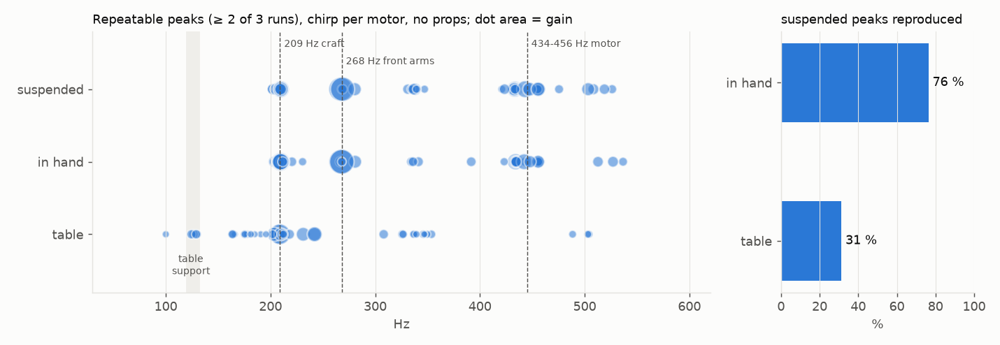
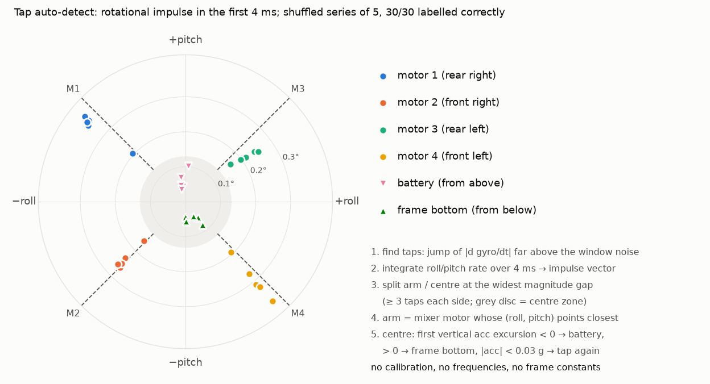
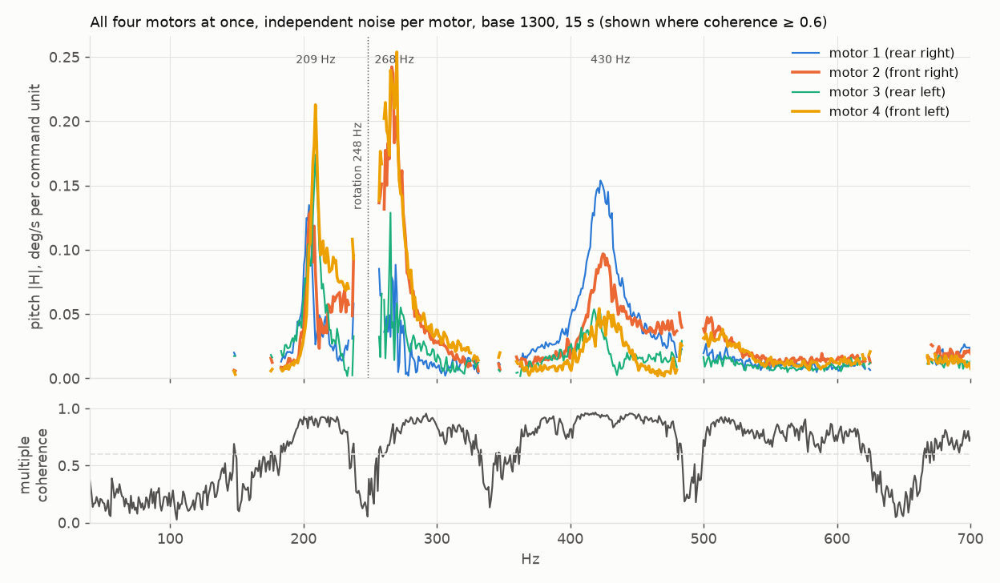

# Motor and frame bench test: results (2026-10-16)

Bench: HAKRCF411D in a 5" frame, four motors, ESCs on Bluejay 0.21 with bidirectional DShot, **no props**,
PID 4 kHz, blackbox to onboard flash at 1/1 or 1/2. Host scripts in `tools/`, full lab notes in `NOTES.md`.

## 1. Which support gives the right answer

Chirp 20-900 Hz on every motor, 3 repeats per support. The suspension is the reference.

| support | suspended peaks reproduced | median freq error | median gain ratio | strongest mode per motor |
|---|---|---|---|---|
| table | 31 % | 1.9 Hz | 0.77 | 1 / 4 |
| held by the battery | 76 % | 0.7 Hz | 1.01 | 4 / 4 |

All three repeat equally well (freq spread < 1 Hz, gain spread 4-6 %), so repeatability alone hides the error:
the table moves the front-arm mode 268 → 242 Hz and adds its own modes. Held by the battery is as good as the
suspension for everything above ~200 Hz.

## 2. Tap test and auto-detect of the tapped point

Motors stopped (RECORD session), finger taps. The tap confirms 209, 268 and 335 Hz as frame modes and adds 75 Hz,
which a propless motor cannot excite. 434-456 Hz is excited only through the motor (rpm dependent: rotor/bell).
A hand grip adds low-Q modes (56-90 Hz, Q <= 10) and pulls centre modes 4-5 Hz down; modes away from the grip
(272 Hz) are unchanged.

Which point was tapped is found from vectors only (no frequencies, no calibration): 30/30 on shuffled series of 5,
84/87 on all earlier logs with 3 "tap again" and 0 wrong.

## 3. All motors in one run

Independent noise per motor (firmware flag), 15 s at two base speeds. A multi-input fit separates each motor's
path; two speeds separate rotation harmonics (at 1150 the 2nd harmonic sits on the 268 Hz mode) from fixed modes.

## 4. Quick full test (what a wizard would run)

Battery connected, craft held by the battery, ~2.5 min:

1. 40 s free tap window: battery from above, frame bottom from below, each arm from above, any order.
2. 30 s all motors with independent noise, base 1150 then 1300.

Output: modes with frequency, Q and class (frame / centre / possibly grip / motor-driven / rotation-related),
per-motor gains, command → rpm per motor. Example: `full_free2_report.txt`.

## 5. What it buys for filtering (estimates, not yet flown)

Betaflight defaults: gyro PT1 250-500 Hz + PT1 500 Hz, D-term PT1 75-150 Hz + PT1 150 Hz, dynamic notch
3 x 100-600 Hz, RPM filter 3 harmonics. A PT1 delays by 1 / (2 pi fc) at low frequency.

| change a known map allows | delay now | after | gain |
|---|---|---|---|
| gyro LPF1 250 → 500 Hz | 0.64 ms | 0.32 ms | -0.32 ms |
| gyro LPF2 500 Hz off | 0.32 ms | 0 | -0.32 ms |
| gyro path total | 0.96 ms | 0.32 ms | **-0.64 ms** |
| dynamic notch 3 → 1, static notches at mapped modes and Q | - | - | no hunting, notch Q matched |

Two findings change filter setup directly: the 75 Hz frame mode is below the default dynamic notch range
(100 Hz), and the 434-456 Hz group moves with rpm without being a rotation harmonic. Not covered without props:
mode shift from prop mass, blade-pass and prop imbalance noise, propwash. Next step: one hover log against the map.

## 6. Safety compared with today's Motors tab

| | Motors tab today | bench session |
|---|---|---|
| host or cable lost | last value is held, no timeout | motors stop after the keepalive timeout (1 s default) |
| arming | - | session ends |
| battery critical | - | session ends |
| command limit | slider up to max | hard cap 1800, per-session max, ramp in |
| tap phase | - | motors not commanded |

Dry state-machine test: 17/17 (start, stop, timeout, rejects, chirp end, clipping report, hand-over).
