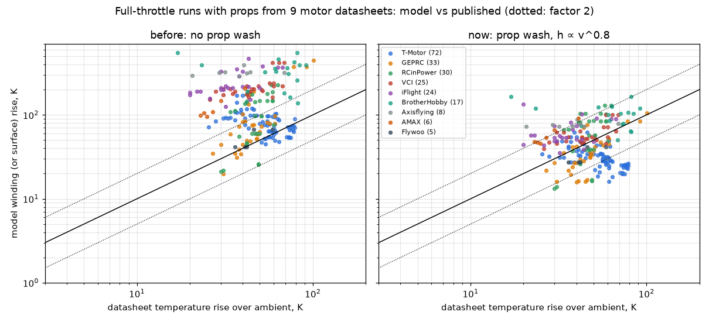

# Motor thermal estimator: datasheet validation and high-load calibration (2026-10-21, updated 2026-10-22)

Firmware: betaflight/betaflight#15848, commits "Motor thermal: prop wash cooling, climb and descent airflow" and
"Motor thermal: resistance size law refitted on 772 motor datasheets".
Data: [datasheets/motor_datasheets.json](datasheets/motor_datasheets.json) (1540 motors of 58 brands, with source URLs;
969+ with a published resistance, 950+ with an idle current, 285 usable full-throttle temperature points).
Scripts: [datasheet_check/](datasheet_check/) (Python replica of `flight/motor_thermal.c`; it matches a host build of the firmware file within 0.3 °C on the bench sets).

## Why

The bench fit (camera on the windings, RESULTS.md) has no prop on the test motor and runs at 7-12k rpm and 1-5 W.
The first datasheet points with a prop and a temperature (GEPRC GR1408 3500KV, iFlight XING 1204 4500/6500KV,
full throttle, 43-62 °C published) came out at 185-255 °C in the model. A collection of published motor data then gave
220 usable full-throttle points from 9 brands (stator 7-31 mm, 1S-6S): the model's temperature rise over ambient was
**2.72x** the published one (median, IQR 1.25-4.50), up to 9x for some brands.

## Winding resistance: a size law, not the datasheet value

First pass (169 motors): the old size law R ∝ 1/(KV²·H·D^2.5) read small motors' R 1.6-2.1x low, so the datasheet
"internal resistance" became an input. The extended data set changed that conclusion.

- **The size law, refitted** on 769 FPV-size datasheets (stator 8-32 mm): the exponents of R ∝ 1/(KV²·H^1.29·D^3.95)
  are the same on the first 126 motors and on all 769. The previous law was off by 2.84x on stators of 14 mm and smaller
  and 0.74x above 25 mm (median error x1.40, 90 % within x3.4).
- **The level stays at the reference** (X-NOVA 2203.5 2800KV, 70 mΩ). Published resistances sit at 0.9-1.7x of it
  depending on the brand (BrotherHobby 1.36, DarwinFPV 1.74, T-Motor 1.19, iFlight 1.25, RCinPower 1.06, SunnySky 0.89):
  median x1.24 against the law, x1.17 against a free fit.
- **Which level is right**: 81 BrotherHobby runs publish the copper (winding) temperature with the load row (60 of them
  re-read from the report images). With the law the model's rise is **0.95x** the published one (IQR 0.76-1.25); with
  BrotherHobby's own R it is **1.43x** (IQR 1.16-1.88), with the same spread after centring (x1.25 vs x1.28). Their R
  carries their measuring convention (leads, meter), not extra information about the motor.
- **What the published temperatures are.** Of 1540 motors, 209 publish a temperature; the usable full-throttle points
  (with the load row) split by method:

  | method | brand | points | model / published rise (size law) |
  |---|---|---|---|
  | "copper wire temperature", the windings, mostly 1-2 min, ambient given | BrotherHobby | 81 | **0.95** (IQR 0.76-1.25), median error 15 °C |
  | case surface after 1 min | T-Motor | 68 | 0.51 (IQR 0.35-0.86) against the model's core node |
  | not stated (GEPRC, iFlight, VCI, RCinPower*, Axisflying, AMAX, Flywoo) | | 136 | 1.08 (IQR 0.68-1.63); lower bounds only |

  *RCinPower's "winding" label comes from the collector's notes, not from the datasheet, so it is not counted as stated.
  Only the BrotherHobby points are used to judge the level; the unstated ones are never fitted.
- **Prop wash on the same points**: without the wash term the ratio is 3.25 (IQR 2.38-4.45), with it 0.95; the term was set
  before these points were collected.
- **Consequence**: the firmware keeps `motor_resistance` as a CLI setting for a 4-wire measurement (0 = the law), out of
  MSP; the Configurator's motor database fills in only KV, stator size and magnets. The bench runs (low throttle) do not
  move: the load copper loss is negligible there.
- The ripple-loss scale (noise term) keeps its bench fit; it is not tied to the resistance law.

## Idle current: tried and dropped

The datasheet no-load current, as a ratio to the reference motor, made the bench fit of the 1408 worse (RMSE 1.5 -> 9.5 °C):
the model's no-load term is an effective quantity fitted on the bench (2.5-5x the physical no-load power), not watts.
Datasheets also quote it at different voltages (10 V or 5.5 V). No input for it.

## Prop wash: the missing cooling

*First pass (21 October), on the 220 points of the first 169 motors with all measuring methods mixed. The check on
winding temperatures only (81 BrotherHobby points, collected later) is in the method table above: 3.25 without the term,
0.95 with it.*

The wash speed over the motor, v = n·D·0.252 (the induced velocity the model already used), adds forced convection on the
windings and the stator core, Newton cooling with the turbulent Nusselt exponent:

    extra conductance = (v / 1.0 m/s)^0.8 / R_core-air   (on both nodes, capped at 100 for the 10 ms step)

- The bench motor had no prop, so the bench fit (low throttle) is unchanged to the hundredth of a degree.
- The exponent is checked by the data: with 0.8 the model/datasheet rise ratio shows no trend with wash speed; steeper
  exponents do (each refitted on all points):

|---|---|---|---|---|
| 0-8 m/s | 19 | 1.04 | 1.56 | 0.06 |
| 8-12 m/s | 55 | 0.94 | 1.18 | 0.09 |
| 12-16 m/s | 66 | 0.85 | 0.84 | 0.12 |
| 16-25 m/s | 80 | 1.10 | 0.93 | 0.16 |

(vk refitted per exponent on all points: n 0.8: 0.97 m/s, n 2.0: 4.82 m/s, n 4.0: 0.69 m/s)

- The reference speed 1.0 m/s centres the 220 points. Per brand:

| brand | points | how the temperature was taken | rise ratio before | rise ratio now |
|---|---|---|---|---|
| T-Motor | 72 | motor surface, 1 min at 100 % | 1.40 (0.97-2.43) | 0.54 (0.39-0.83) |
| GEPRC | 33 | not stated / 3-15 s, one 10 min | 1.42 (1.11-2.04) | 0.74 (0.64-0.92) |
| RCinPower | 30 | 3-5 s at 100 % | 2.27 (1.26-3.21) | 1.33 (0.81-1.88) |
| VCI | 25 | shaft, after a 0-100 % sweep | 4.50 (4.01-5.89) | 1.24 (1.08-1.52) |
| iFlight | 24 | not stated (1 min on some) | 6.78 (5.74-8.40) | 1.71 (1.40-2.21) |
| BrotherHobby | 17 | inside copper wire, 10 s-2 min at 100 % | 5.05 (4.28-6.06) | 1.39 (1.07-1.98) |
| Axisflying | 8 | not stated | 8.66 (7.48-10.42) | 2.05 (1.80-2.36) |
| AMAX | 6 | 10 s at 100 % | 4.32 (4.07-4.81) | 2.03 (1.97-2.16) |
| Flywoo | 5 | 3 s at 100 % | 1.14 (1.01-1.15) | 0.70 (0.67-0.77) |
| **all** | **220** | | **2.72 (1.25-4.50)** | **0.99 (0.64-1.57)** |

  Leaving one brand out of the fit, its median stays within 0.47-2.09. What is left is mostly how each brand measures:
  T-Motor the case surface after 1 min (the model's stator core is compared), BrotherHobby the copper inside, VCI the
  shaft after a sweep, RCinPower 3-5 s, GEPRC / iFlight / Axisflying without a duration.

## Craft speed

Airflow from the craft: GPS ground speed (as before) and now the altitude rate of the position estimate (baro / GPS), so
climbs and descents count without GPS.

## Classic flight scenarios (model, ambient 25 °C, peak winding rise)

Inputs: per-motor current from the datasheet prop tables at full throttle and a typical hover current, DShot rpm,
command noise index 10-20 (filtered tune). Hover 3 min, cruise 3 min at 15 m/s, freestyle 4 min (3 s punch every 20 s),
race 2.5 min (70 % average, 25 m/s), full-throttle climb 20 s at 18 m/s then descent.

| motor | hover | cruise 15 m/s (GPS) | freestyle (punch 3 s / 20 s) | race (70 % avg, 25 m/s) | full-throttle climb 20 s, then descend |
|---|---|---|---|---|---|
| 1204 4500KV 3S 2.5" (XING) | +20 K | +22 K | +67 K | +67 K | +75 K |
| 1408 3500KV 4S 3" (GEPRC) | +13 K | +14 K | +36 K | +37 K | +42 K |
| 2203.5 2800KV 4S 4" (X-NOVA) | +9 K | +10 K | +38 K | +43 K | +47 K |
| 2207 1950KV 6S 5" | +9 K | +10 K | +49 K | +54 K | +60 K |
| 2806.5 1300KV 6S 7" | +11 K | +12 K | +45 K | +54 K | +60 K |

All five with `motor_resistance` 0 (the size law), as a Configurator user gets them.

## Limits

- Full throttle: checked on the one brand that states a winding temperature (81 points, ratio 0.95, IQR 0.76-1.25).
  T-Motor's 1-min case surface is 2x the model's core rise while the windings fit: open (the case may read close to the
  windings, or the core-to-air path is too strong at full throttle). One point can still be off by 1.3x.
- Prop wash: refitting its speed and exponent on the 81 BrotherHobby winding points gives nothing out of sample (5-fold
  by motor, RMS log error 0.434 -> 0.434); the fitted speed is 1.05 m/s against the firmware's 1.0.
- Partial throttle with a prop has no ground truth yet: the datasheets give the temperature only at full throttle, the
  bench had no prop. The exponent comes from physics and the wash-speed check above, not from hover data.
- The no-load term is the bench-fitted effective one (above the physical no-load power).
- Cheapest flight check: hover 3 min, land, measure the motors within 10 s (IR thermometer or thermocouple), with
  `debug_mode = MOTOR_THERMAL` in the log.

## Reproduce

    python3 datasheet_check/dsdoc.py datasheets/motor_datasheets.json     # tables above
    python3 datasheet_check/dsplot.py datasheets/motor_datasheets.json out.png
    python3 datasheet_check/rlaw_fit.py datasheets/motor_datasheets.json   # resistance and no-load size laws
    python3 datasheet_check/rvalue.py datasheets/motor_datasheets.json     # law vs datasheet R by measuring method
    python3 datasheet_check/washcv.py datasheets/motor_datasheets.json     # prop wash refit, cross-validated
