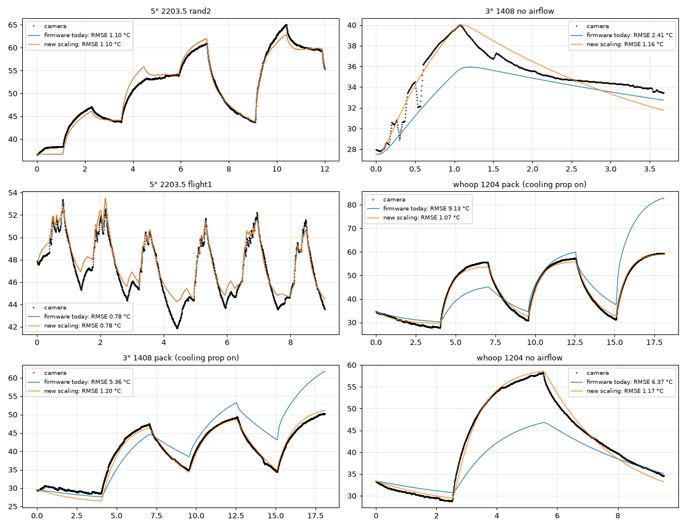

# Motor thermal bench, session 2026-10-14

Setup: MAMBAF722 (BF 26.12.0, DSHOT600, bidir on, no EDT), motor on pad M2, no prop,
TC001-class USB thermal camera looking down at the bell top (hot spots seen through
the bell spokes), ROI 90,40,115,115. Power: ToolkitRC P200 at 16.8 V for run a_base,
then 4S Li-ion (13.8 → 13.45 V) for the rest. Command via MSP_SET_MOTOR (~100 Hz max).

| run        | cmd        | rpm  | motor W | T∞ °C | tau min | note                         |
|------------|------------|------|---------|-------|---------|------------------------------|
| a_base     | 1150 ± 0   | 7720 | 0.84    | 40.6  | 0.9     | PSU 16.6 V, 5 min            |
| a2_base    | 1150 ± 0   | 6325 | 0.26    | 37.1  | 1.0     | battery 13.7 V               |
| c_base1210 | 1210 ± 0   | 8616 | 0.88    | 40.1  | 0.4     | battery, started warm        |
| b_s50      | 1150 ± 35  | 7340 | 1.54    | 41.9  | 0.8     | sine ±50 @ 20 Hz             |
| d_s80      | 1150 ± 57  | 8143 | 2.58    | 48.4  | 0.8     | sine ±80 @ 20 Hz             |

motor W = (I_adc − 0.20 A idle) × V. ADC current is quantised at 0.01 A, so ±0.15 W.
T∞ from an exponential fit of the ROI max over the hold phase (plot_run.py).

## Findings

1. Zero-mean command noise heats the motor hard: at the same mean command, ±35 raised
   motor power 0.26 → 1.54 W, ±57 raised it to 2.58 W. Against baselines at similar
   mean rpm (~0.6 and ~0.8 W) the extra power is ≈0.9 W and ≈1.8 W, ratio 2.0 for an
   amplitude ratio of 1.6 (squared 2.6). Roughly variance-proportional, within the
   coarse current resolution.
2. Noise shifts the mean rpm up (+1000 at ±35, +1800 at ±57): the ESC's throttle →
   rpm map is non-linear and acceleration is stronger than braking. Baselines must be
   compared at the same mean rpm, not the same mean command.
3. The bell under-reports: baseline (iron/magnet losses, in the bell) gives ~17–31 K/W,
   noise runs (copper losses, in the stator) give only ~4–6 K/W on the bell. A
   thermocouple on the stator end turns is needed for an absolute winding model.
   For run-to-run comparison the camera is fine.
4. The bell temperature jumps +2 °C the instant the motor stops (smeared rotating
   surface vs. stationary hot spot). Compare only equal spin states.
5. No-prop at 20 Hz is a rpm-swing regime (±1000 rpm), not the winding-current-ripple
   regime of real D-term noise at 100–300 Hz. MSP cannot go above ~20 Hz; the HF regime
   needs a firmware hook (noise on motor N at PID rate) — not done, awaiting approval.
6. Regenerative braking of the bare bell tripped the P200's OVP within 5 s of the first
   noise run. Use a battery for any run that modulates rpm.
7. Betaflight serial task limits MSP motor updates to ~100 Hz (measured 90–100 Hz).

## Operational notes

- Stop bench tabs with Ctrl-C only. Closing the tab kills bench.py without its
  finally block and the motor keeps spinning (happened once, caught and stopped via MSP).
- bench.py guards: --max-amps 1.0, --min-vbat 10.8, --max 1500, noise_hz <= rate/4.
- 180 s per run is enough (3 tau). Cool to < 27.5 °C between runs if absolute start
  temperature matters; for T∞ comparison a warm start is acceptable.
- Camera must be run from a terminal tab (TCC); it picks "USB Camera" by name via ffmpeg.

## Next

- Firmware hook for HF noise (needs user approval to flash MAMBAF722), then repeat
  b/d at 100, 200, 400 Hz: expect rpm swing to vanish and heating to stay.
- Thermocouple/NTC on stator (spare ADC pad) for absolute winding temperature.
- Baseline T∞(rpm) curve with 3–4 points to subtract iron losses properly.
- Point the camera at the FC/ESC during a noise run: some of the extra bus power may
  be dissipated in the ESC FETs, not the motor.

# Session 2, 2026-10-15: windings in view, on-board noise hook

Changes vs session 1: bench firmware with USE_BENCH_NOISE (noise injected at the 4 kHz PID
loop, see firmware/README.md); camera moved to look at the stator windings from the side
(ROI 103,44,50,40, hot spot at ~(142,69)); 4S Li-ion at 16.2 V; 180 s runs; DShot beacon
disabled (it was pulsing the test motor between runs); camera shutter-recalibration steps
(whole-frame jumps of 1.4–2.1 °C) removed in plot_run.py; cooldown to 29 °C between runs.

| run                 | noise (rms, units) | rpm   | bus W | base W @rpm | ΔP W | T∞ °C | base T∞ @rpm | ΔT °C | K/W |
|---------------------|--------------------|-------|-------|-------------|------|-------|--------------|-------|-----|
| a_base1150          | 0                  | 7525  | 0.74  | 0.74        | 0    | 39.4  | 39.4         | 0     | –   |
| b_base1210          | 0                  | 10328 | 1.30  | 1.30        | 0    | 42.6  | 42.6         | 0     | –   |
| c2_msp_s50_20       | sine 35, 20 Hz     | 8681  | 2.34  | 0.97        | 1.37 | 44.9  | 40.7         | 4.2   | 3.1 |
| d_ob_s50_100        | sine 35, 100 Hz    | 7435  | 2.94  | 0.72        | 2.22 | 44.4  | 39.3         | 5.1   | 2.3 |
| e_ob_s50_200        | sine 35, 200 Hz    | 7431  | 2.62  | 0.72        | 1.90 | 44.7  | 39.3         | 5.4   | 2.8 |
| f_ob_s50_400        | sine 35, 400 Hz    | 7421  | 2.56  | 0.72        | 1.84 | 42.1  | 39.3         | 2.8   | 1.5 |
| g_ob_w50_200        | white 50, LP 200   | 7461  | 3.47  | 0.73        | 2.74 | 50.3  | 39.3         | 11.0  | 4.0 |

Baseline interpolated linearly in rpm between a and b. T∞ from a single-exponential fit
over the 180 s hold (tau ≈ 0.6 min); a slower second time constant is visible, so all T∞
are slightly low, equally for every run.

## Findings

1. On-board noise at ≥100 Hz is the real D-term regime: mean rpm stays at the baseline
   (7435 vs 7525) with only ±200 rpm aliasing wobble, so all excess power is winding
   current ripple, not acceleration/braking. At 20 Hz over MSP the rpm swings ±2000 and
   the mean rpm shifts up by 1100.
2. Cost of noise on the windings, no prop airflow: ±35 rms (±50 peak) on a 1150 command
   gives +1.9–2.2 W bus and +5.1–5.4 °C at 100–200 Hz, i.e. ~2.5 K per excess watt.
3. Variance law holds on temperature: white noise with 2.0× the variance (rms 49.8 vs
   35.4) gave 2.0× the winding rise (11.0 vs 5.4 °C). The bus-power excess only rose
   1.4×, so the FC current sensor is the weak link, not the thermal model.
4. Frequency roll-off: at 400 Hz the winding rise halves (2.8 °C) while bus power barely
   drops. Winding inductance filters the current ripple, and a growing share of the ripple
   energy is dissipated in the ESC rather than the copper. Bus power therefore
   overestimates motor heating at high frequency; a run with the camera on the ESC would
   quantify the split.
5. Windings vs bell: on the windings there is no post-stop jump (0.7 °C above plateau vs
   +2 °C on the bell) and the K/W of baseline iron loss is ~6 (0.74 W → +11.5 °C over
   ambient) against 17–31 on the bell yesterday.
6. Instrumentation issues found: FC current ADC sampled at 5 Hz aliases with sine noise at
   multiples of 5 Hz (beat at 100 Hz, possibly phase-locked at 400 Hz); camera shutter
   recalibration adds 1.4–2.1 °C steps; a stale ffmpeg from a sandboxed shell froze the
   camera once; DShot beacon pulsed the stopped motor and slowed cooldown.

## Pending

- h_ob_s80_200 (sine ±80 at 200 Hz): amplitude scaling check at HF. Not run yet.
- Use 101/201/401 Hz (not multiples of 5 Hz) to break the current-ADC aliasing, or
  average the current on-board.
- Second camera ROI on a cold reference to cancel shutter steps instead of detecting them.
- Camera on the ESC during a noise run (ESC vs winding share).
- Thermocouple on the windings for absolute calibration (user has one).

# Session 3, 2026-10-16: amplitude scaling at HF, own baseline

Motor: X-NOVA Lightning V2 2203.5, 2800 KV. Camera re-aimed on the windings (ROI 100,45,80,60),
plateaus read ~7 °C lower than session 2 for the same power, so only same-day comparisons.
Sine at 201 Hz (not a multiple of the 5 Hz current sampling).

| run             | rms  | rpm  | bus W | ΔP W | T∞ °C | ΔT °C | K/W |
|-----------------|------|------|-------|------|-------|-------|-----|
| a_base1150      | 0    | 7489 | 0.63  | 0    | 32.3  | 0     | –   |
| e2_ob_s50_201   | 35.3 | 7407 | 2.62  | 1.99 | 42.0  | 9.7   | 4.9 |
| h_ob_s80_201    | 56.5 | 7401 | 4.40  | 3.77 | 53.5  | 21.2  | 5.6 |

Variance ratio 2.56; ΔT ratio 2.19; ΔP ratio 1.89.

- ΔT ratio 2.19 ≈ 2.56^0.8: heating is quadratic in rms, temperature rise is sub-linear in
  power because natural convection improves with ΔT (h ∝ ΔT^0.25 → ΔT ∝ P^0.8). Consistent
  with session 2 white-noise result (×2.0 variance → ×2.0 ΔT, smaller rise).
- ΔP ratio 1.89 < 2.56: the FC current ADC under-reads the excess at larger amplitude
  (quantisation 0.01 A at 5 Hz). Temperature is the trustworthy channel; bus power is a
  lower bound.
- Bus power at 201 Hz equals the 200 Hz value (2.62 W) → no aliasing at 200 Hz in session 2.

## Model with KV and stator size

Betaflight uses motor_kv in only two places: the RPM limiter (motor.c motorEstimateMaxRpm,
unloaded rpm = 0.01·Vbat·KV with a load derating) and the wing TPA speed model
(pid_init.c propMaxSpeed). Nothing thermal. The Configurator shows the KV field only for
USE_WING builds (MotorsTab.vue isMotorKvSupported), quads can set it only via CLI.

Command noise is duty noise: ΔV ≈ Vbat·Δduty on the winding; above ~100 Hz rpm does not
follow, so the back-EMF is constant and the ripple current is ΔV / |R + jωL|, loss I²R.
For a given stator rewound to another KV: N ∝ 1/KV, wire area ∝ 1/N, R ∝ N² ∝ 1/KV². Hence

    ΔP_copper ∝ (Vbat · σ_duty)² / R ∝ (KV · Vbat · σ_duty)²

KV·Vbat is the unloaded rpm Betaflight already computes. Stator size enters via thermal
capacity (∝ D²H), thermal resistance (∝ 1/(area·airflow)) and the copper volume (R at fixed
KV ∝ 1/(D²H)). On-board estimator form:

    ΔT_winding ≈ k_motor · (KV · Vbat · σ_cmd)² · G(f),   k_motor ∝ R_th / (D²H)

Calibration for 2203.5/2800 KV, no prop airflow, 201 Hz: σ_cmd 35.3 units = 3.5 % duty,
Vbat 16.2 V → KV·Vbat·σ = 1590 rpm-equivalent, ΔT 9.7 °C → k ≈ 3.8e-6 °C/rpm².
(Session 2 gave 8.6e-6 with the other camera aim; absolute k needs the thermocouple.)
G(f): ≈1 at 100–200 Hz, ≈0.5 at 400 Hz (session 2).

Pending: phase-to-phase resistance (user measuring on a sibling motor), camera on the ESC
for the ESC/winding loss split, thermocouple for absolute calibration, Configurator PR to
show motor_kv for quads.

## ESC share (camera on the FC/ESC board, session 3)

Base 1150 for 180 s, 4 min gap, then sine ±80 @ 201 Hz for 180 s; full frames dumped every
5 s (logs/esc_frames), difference map in logs/esc_diff.png (esc_diff.py). FET strip at the
motor pads = ROI 62,90,23,50 (user-identified).

| | FET strip max rise | FET strip mean rise | whole board | motor phase wires |
|---|---|---|---|---|
| base run (0.63 W motor) | 0.0 °C | −1.6 °C | ~0 | ~0 |
| noise run (4.4 W bus, 3.8 W excess) | +12.5 °C | +7.6 °C | +4…6 °C | +6…8 °C |

Phase-to-phase resistance measured on a sibling 2203.5: 0.4 Ω reading − 0.2 Ω leads =
0.2 Ω line-to-line (±0.1), 0.1 Ω per phase. I²R check for ±50 @ 201 Hz: 3.5 % duty ripple
× 16.2 V = 0.57 V rms → 2.8 A rms → 1.6 W vs 1.99 W excess on the bus: consistent within
the meter's resolution.

Conclusion: HF command noise heats the ESC FETs and the phase wires measurably, not only
the windings. The excess bus power is split between copper (windings + wires) and ESC
switching/conduction loss; the split in watts needs the board's thermal resistance (not
measured), but the FET hot spot rising 12.5 °C in 3 min from a 3.8 W excess shows the ESC
share is not negligible. For the on-board estimator this means two thermal nodes
(winding, ESC) fed from the same command-variance term, each with its own k and G(f);
ESC temperature is actually available via EDT on ESCs that report it, which gives a
direct check for that node in flight.

## PR plan: motor section (decided 2026-10-16)

- Configurator, Motors tab: show `motor_kv` for all builds (today only USE_WING) and add a
  stator size field (diameter × height, e.g. 2203.5). These two numbers feed the thermal
  estimator's gain (KV·Vbat) and the stator scaling of k, Cth, Rth.
- Firmware: new motor-config fields for stator size; `motor_kv` already exists.
- Post-landing temperature calibration is CLI-only (advanced users): a parameter that takes
  the measured motor temperature after a flight; firmware adjusts k from what it predicted.
  Not exposed in the GUI.
- ESC node self-calibrates from EDT temperature when available; no user input.
- Without any input the raw noise index (command units) remains available.

## Session 3b: on-board noise index + thermal model validation (2026-10-16)

Firmware v2/v3 (firmware/bench_noise_hook_v3.patch): `motor_noise.c` computes per-motor HF
RMS of the final command in two bands (>80 Hz, >300 Hz; PT1 highpass + 0.5 s EMA) at PID
rate; `DEBUG_MOTOR_NOISE` exposes all four motors, the bench debug mode exposes the tested
motor's bands over MSP. Verified: injected sine 35 rms @201 Hz reads 30.9 (>80) / 18.2
(>300), matching the filter gains. v3 fixes stale channels when injected amplitude is 0.

Two-node winding/core model (thermal_model.py), inputs only rpm, vbat, hf80, hf300:
  Ts' = (P_cu − (Ts−Tc)/Rsc − (Ts−Tamb)·air/Rsa)/Cs,  Tc' = (P_iron + (Ts−Tc)/Rsc − (Tc−Tamb)·air/Rca)/Cc
  P_iron = a·(rpm/1000)², P_cu = kc·(Vbat/16)²·((hf80²−hf300²) + ghi·hf300²)/35², air = 1 + b·rpm/1e4

| data set | regime | RMSE | max |err| |
|---|---|---|---|
| rand1 + rand2 (fit, 18 min, 45–90 s segments) | random base/noise/freq | 1.28 °C | 2.6 °C |
| flight1 (test, no refit, 9 min, 0.3–15 s segments, 6 takeoff/landing cycles) | flight-like | 1.38 °C | 3.7 °C |

Fitted: Cs 15 J/K, Cc 136 J/K, Rsc 0.6 K/W, Rca 3.5 K/W, a 0.28 W/krpm², kc 14.2 W-eq @35 rms,
ghi 0.75 (HF band weight, matches the 400 Hz roll-off), b at the upper bound (airflow term
under-determined without prop). Residual: +1…2 °C during stopped-motor cooling (model cools
too slowly at rpm 0); fast rises slightly late.

Lesson: the bench debug channels froze at amplitude 0 (v2); schedule-based zeroing was used
for the analysis, fixed in v3.

### GUI spec update (2026-10-16): motor fields

- `motor_kv` (all builds), stator size (e.g. 2203.5), prop diameter.
- Prop diameter defaults to "auto": derived from stator size and KV by a lookup
  (e.g. 08xx→65 mm whoop, 11xx–12xx→2.5–3", 14xx→3–3.5", 16xx–18xx→3.5–4", 2203–2204→4–5",
  2205–2207→5" (KV>2300: 4S, else 6S), 2306–2307→5–5.5", 2806–2810→7", 3110+→8"+).
  The user can override. The thermal estimator uses it only for the prop-induced air speed,
  which is a minor term next to bell speed; craft speed (TPA speed estimate) matters more.

### GUI spec final (2026-10-16): GUI = motor_kv + stator size only. Prop diameter is a CLI
parameter with "auto" default (lookup from stator/KV); not shown in the GUI since its
thermal effect is minor. Post-landing temperature calibration also CLI-only.

### Model v3 (convection via total air speed at the stator) and second flight test

air = 1 + b·(v/10 m/s)^e, v = RSS(bell surface speed, prop induced v = n·D·sqrt(2Ct/π), craft
speed from the TPA speed estimate). Bench: prop and craft terms are zero, so the bench
calibrates b, e on bell self-ventilation (5–12 m/s). Fit b 1.45, e 1.5 (upper bound).

| data set | RMSE | max |err| |
|---|---|---|
| rand1+rand2 (fit) | 1.07 °C | 2.9 °C |
| flight1 (test) | 0.72 °C | 2.2 °C |
| flight2 (test, fresh run, v3 firmware) | 1.32 °C | 3.7 °C (first two cycles under-predicted: core state initialised equal to the surface after a warm previous run) |

What-if with the same inputs: 5" prop at hover changes little (prop induced 4 m/s vs bell 11
m/s), craft speed 10 m/s lowers the peak by 4 °C, 25 m/s by 8 °C. Above 12 m/s the
convection law is extrapolated.

# Session 4, 2026-10-21: three motors, size and magnet scaling

Same method on two more motors: thermal camera on the windings (through the bell), 201 Hz sine
injected on one motor by the MSP2 motor excitation firmware (#15851), base command 1150, 4S,
180 s runs. A second motor ran a prop at 1100 throughout to cool the VTX/air unit.

| motor | stator | magnets | rpm at 1150 | ROI | noise rise | baseline plateau over ambient |
|---|---|---|---|---|---|---|
| X-NOVA 2203.5 2800KV (reference) | 22×3.5 | 14 | 7 500 | windings, side view | ±50: +10 K | +11 K |
| GEPRC 1408 3500KV (3", closed bell, HAKRCF411D) | 14×8 | 12 | 10 200 | 128,96,16,16 (slot) | ±20: +1.6 K, ±30: +3.9 K | +21 K |
| XING 1204 4500KV (A75 whoop, IFLIGHT_F411_PRO) | 12×4 | 12 | 11 900 | 112,104,16,16 | ±25: +1.4 K, ±40: +4.1 K | ≈ +25 K (next to the VTX) |

- Noise heating still follows the command variance (rise ratio ≈ variance ratio on both motors).
- Small motors: the old laws over-estimated the noise heating up to 5× (1408) and 11× (1204), and
  under-estimated the no-load heating and its speed (time constants 0.5–1 min).
- Cooling prop on another motor: the resting test motor cools 3–4× faster (1408: τ 435 s → 104–151 s);
  a spinning test motor barely changes (1204 base: T∞ 56.5 °C without, 53.8 °C with). Both motors got
  a no-airflow segment so that the fit can separate airflow from heat capacity.
- Bus current is a weak check on these boards (1408: 0.36 / 0.67 W excess; whoop AIO: 0.06–0.09 W).

Joint fit (scaling_fit.py; reference constants fixed, all ratios 1 at the reference):

| term | before | after |
|---|---|---|
| ripple copper loss, winding resistance | ∝ H | ∝ H·D^2.5 |
| no-load loss at a given rpm | ∝ D²·H | ∝ D^0.15·H^0.25 · magnets/14 |
| heat capacity | ∝ D²·H | ∝ D²·(H + 12 mm) |
| thermal resistances | ∝ 1/ratio | ∝ 1/√ratio |

| data set | RMSE before | RMSE after |
|---|---|---|
| 2203.5 rand1 / rand2 / flight1 / flight2 | 1.25 / 1.10 / 0.78 / 1.22 °C | unchanged |
| 1408 pack (cooling prop) / no airflow | 5.36 / 2.41 °C | 1.20 / 1.16 °C |
| 1204 pack (cooling prop) / no airflow | 9.13 / 6.37 °C | 1.07 / 1.17 °C |

Limits: three motors, 12–22 mm stators; both new motors have 12 magnets, so the magnet term is set
by physics (linear in electrical frequency), not fitted. The camera sees the windings through the bell
and out of focus, so absolute temperatures read low; rises and time constants are not affected.
Committed as fdb4018d3 on #15848 and merged into #15851.

