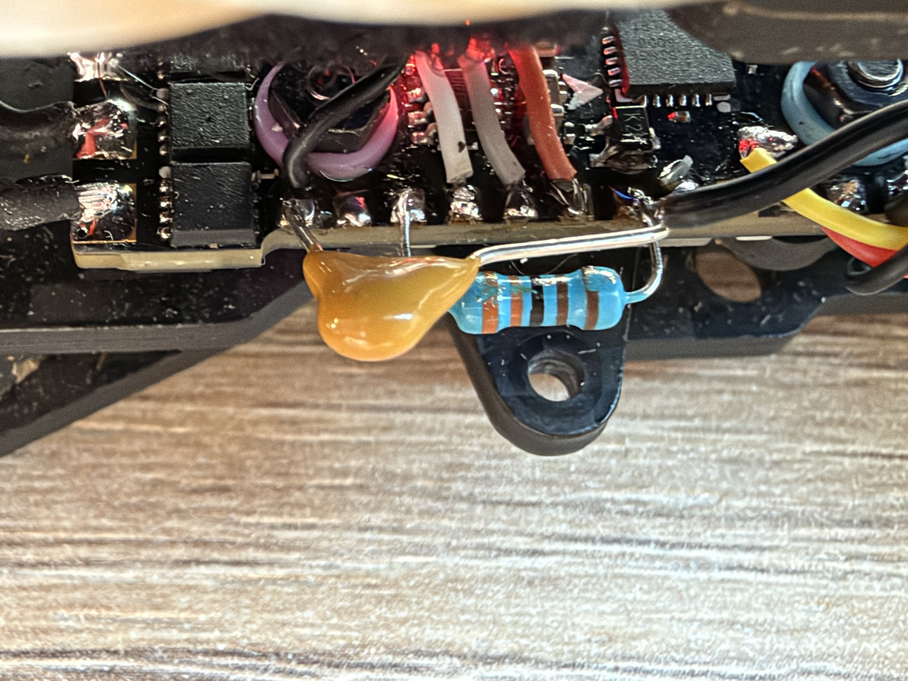
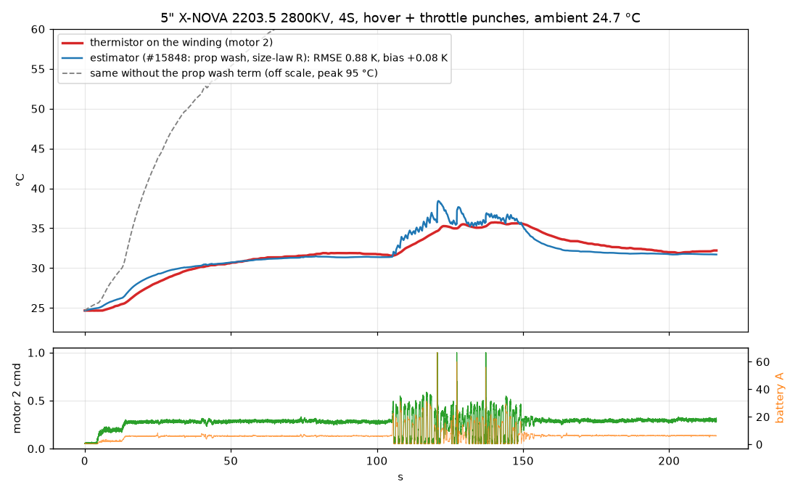

# First flight with a thermistor on a winding (2026-10-22)

Craft: 5", X-NOVA Lightning V2 2203.5 2800KV, 4S, HAKRCF411D, Bluejay 0.21 ESCs, bidirectional DShot.

## Sensor

NTC 10k (B 3950) glued with thermal paste and epoxy to the end turns of motor 2, wires along the arm under kapton.
Divider on the free TX2 pad (PA2, ADC1_IN2):

    3V3 ── 3.3 kΩ ──┬── PA2 (TX2)
                    ├── NTC 10k ── GND   (on the winding)
                    └── 100 nF ── GND    (at the FC)

    resource SERIAL_TX 2 NONE
    resource ADC_RSSI A02
    feature RSSI_ADC
    set blackbox_disable_rssi = OFF
    set debug_mode = MOTOR_THERMAL

The blackbox `rssi` field is the ADC / 4 (v = 0..1023): R_ntc = 3300·v / (1023 − v), T = 1 / (1/298.15 + ln(R/10k) / B) − 273.15.
At rest the thermistor read 26.3 °C against 26.8 °C on a thermal camera aimed at the same spot.

## Flight

216 s indoors: hover (motor command ~0.28, 9.2k rpm), throttle punches up to 100 % at 105–150 s, hover again.
Log: [ntc_hover_20261022.bbl](ntc_hover_20261022.bbl), blackbox 1 kHz.

The flight controller ran an older build (no prop wash term) with two configuration errors found afterwards, so the
estimator was replayed on the host with the current firmware file (`flight/motor_thermal.c` of #15848), from the
logged rpm, motor commands, battery voltage and current:

- the current sensor scale was 400 instead of the board's 160: the logged current is multiplied by 2.5 (hover 6 A, ~80 W);
- the ambient came from the board sensors (gyro / baro / MCU, 34 °C on a board warmed by USB): the replay starts at the
  thermistor's 24.7 °C. The firmware now asks the ESCs for extended telemetry before arming, so a cold ESC sets the ambient
  (24–27 °C against 25.8 °C on the thermistor on this craft);
- the noise index is recomputed from the 1 kHz motor log (the firmware computes it at the PID rate).

| motor 2, whole flight | |
|---|---|
| estimator vs thermistor (1 s average) | **RMSE 0.88 K, bias +0.08 K, max 3.7 K** |
| end of the flight | 31.7 °C vs 32.2 °C |
| peak during the punches | 38.4 °C at 121 s vs 35.7 °C at 140 s |
| the same estimator without the prop wash term | RMSE 39.8 K (peak 95 °C) |

No constant was changed for this comparison.

## Limits

- One flight, one motor, and it is the 2203.5 the bench calibration was made on: this checks the in-flight physics
  (prop wash, airflow, current split), not the size scaling.
- Mild heating (+11 K); a hot flight (sustained full throttle) is not covered yet.
- The current scale 160 is the board default, not checked against a charger yet.
- The thermistor sits on the surface of the end turns and lags; part of the 3.7 K peak difference may be the sensor.
- Next: the same flight on the new build (on-board estimate directly against the thermistor), then another motor size.

## Reproduce

    python ntc_flight.py ntc_hover_20261022.bbl out          # thermistor and on-board debug, per 20 s
    AMPS_K=2.5 python ntc_replay.py ntc_hover_20261022.bbl out EVAL_OLD EVAL_NEW

`EVAL_*` are host builds of `flight/motor_thermal.c` (four-motor driver around the firmware file, as used for the bench
validation); `orangebox` parses the log.
